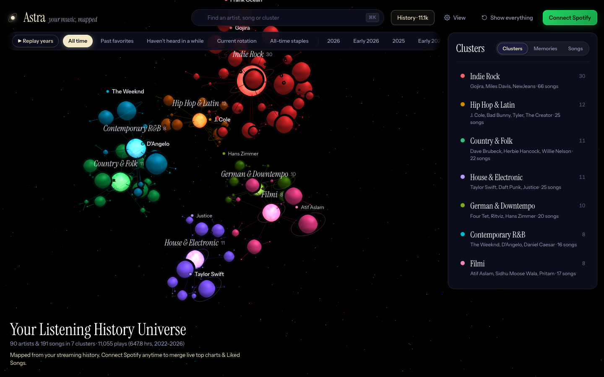
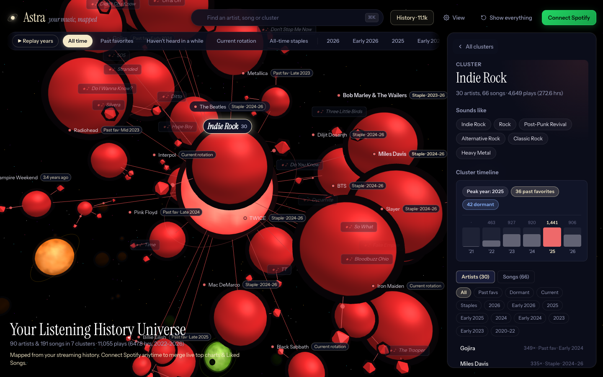
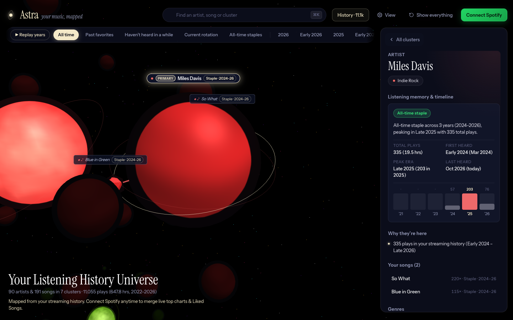
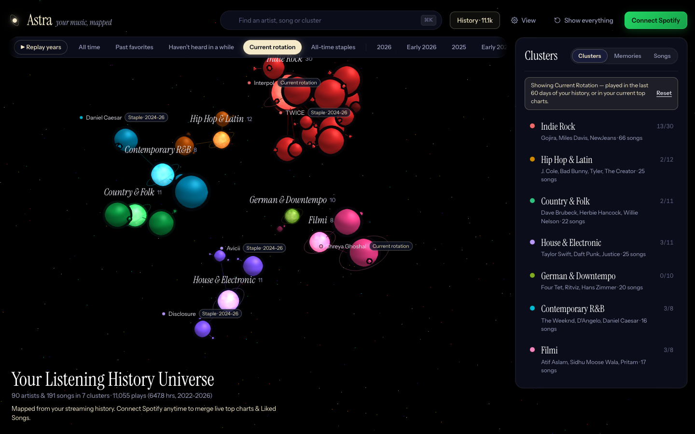
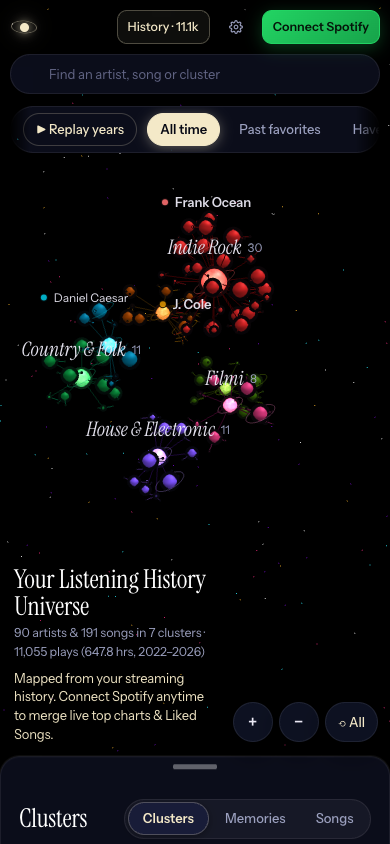
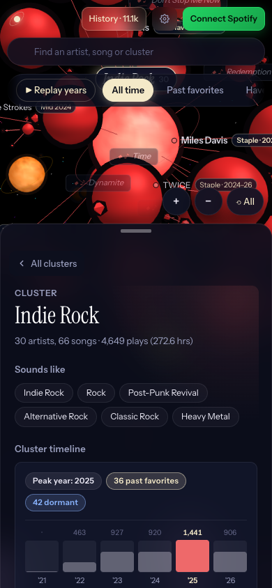
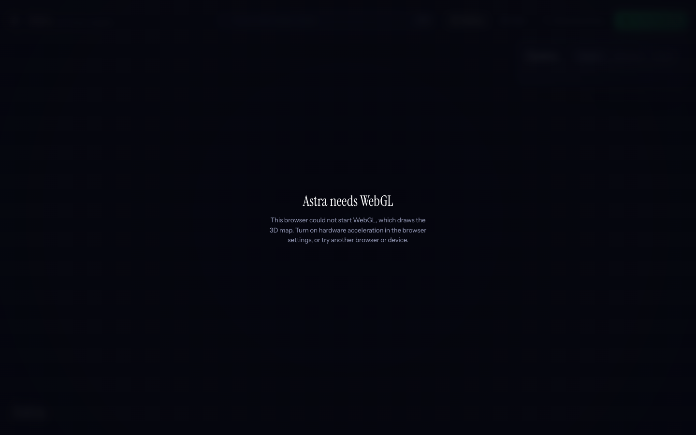

# Astra

[](https://github.com/pushpam2404/astra-3d-music-universe/actions/workflows/ci.yml)

Astra turns your Spotify listening into a 3D map you can fly around. Artists that share genres, a home country, collaborations or listening sessions end up in the same cluster. Each cluster gets a planet at its centre, artists orbit it as smaller planets, and songs circle their artist as faceted moons.

Live: https://astra-3d-music-universe.vercel.app



The screenshots in this README come from a synthetic history I generated for 90 well-known artists, not from anyone's real account. Genres were looked up through the app's normal pipeline, so a few artists land in odd clusters (Taylor Swift ends up next to Daft Punk) where the lookup found no usable tags.

## What it does

You can feed Astra two ways, and combine them.

- Connect Spotify to read your top artists and tracks for three time ranges, recent plays and Liked Songs.
- Import your Spotify "Extended Streaming History" (the `.zip` as downloaded, the unzipped folder, or the `Streaming_History_Audio_*.json` files). Parsing and clustering run in the browser, so a 100 MB export never goes through a server.

From there:

- Genres come from public data, because Spotify no longer returns artist genres to apps in development mode. Astra looks artists up on Wikidata and MusicBrainz, plus Last.fm if you give it an API key, and keeps the results in `localStorage` for 30 days.
- Clusters are found with Louvain community detection on a similarity graph (shared genres and countries, collaborations, songs played in the same session). Positions come from a 3D UMAP embedding, then a collision pass keeps planets from overlapping.
- Cluster names are picked from the genres that set a cluster apart from the others (class-based TF-IDF). If a group has no real genre of its own it is merged elsewhere or labelled "Genre Unknown" instead of getting an invented name.
- Lenses filter the whole map and the side panel together: past favourites, things you have not heard in a while, current rotation, all-time staples, and one lens per year in your history. "Replay years" steps through the years.
- Selected artist, cluster and lens live in the URL (`?node=&lens=`), so Back and Forward work and links reopen the same view.
- You can export the computed map as a snapshot `.json` to re-import later, or the aggregated history as `.csv`.

| Cluster focus | Artist | Lens: current rotation |
|---|---|---|
|  |  |  |

| Mobile | Mobile, cluster sheet | No WebGL |
|---|---|---|
|  |  |  |

## How it is put together

```text
Browser                                           Express / Vercel function
-------                                           -------------------------
Three.js scene (src/renderer)                     /api/auth/*      Spotify OAuth, session in an
HUD and detail panel (src/ui)                                      encrypted HttpOnly cookie
History parser, merge and clustering   <------->  /api/universe    Spotify signals only (no history)
  (src/etl, server/clustering.js)                 /api/enrich      genre lookups: Wikidata,
IndexedDB: imported history, snapshots                             MusicBrainz, Last.fm
localStorage: Spotify signals (6 h),              /api/genre-vocabulary  genre catalogue, CDN cached
  artist genres (30 days)
```

- `src/main.js` owns the app state and the frame loop. `src/renderer/celestialFactory.js` builds the meshes (instanced artist planets and song moons, one planet per cluster) and applies focus and lens culling. The shaders are in `src/renderer/shaders/`. Everything is opaque on purpose, with a dark outline on pale clusters so overlapping bodies stay readable.
- `src/etl/historyParser.js` parses streaming history. `src/etl/universeAssembler.js` merges it with Spotify data and calls `server/clustering.js` and `server/clusterNaming.js`. Those two live under `server/` but are plain modules, and the browser imports them too.
- Spotify tokens never reach the browser. The server keeps them in an AES-256-GCM encrypted cookie, so any serverless instance can read the session and nothing is stored in a database.
- Spotify calls are cached in the browser for 6 hours, and the app never calls Spotify from the background lookup loop, to stay clear of rate limits (HTTP 429).
- Background lookups refine the map while you are idle: after enough new genres arrive it re-clusters and glides the planets to their new places, drawing a short trail for artists that changed cluster.
- There is no hardcoded table of artists, genres or countries. Which tags count as genres, languages or places is decided from Wikidata and MusicBrainz data, `Intl` names, and how consistently a tag groups similar artists in your own library.

[`CLAUDE.md`](CLAUDE.md) has more detail on the design rules for people working on the code.

## Running it

You need Node 20.12 or newer. Spotify credentials are optional if you only want to explore an imported history.

```bash
git clone https://github.com/pushpam2404/astra-3d-music-universe.git
cd astra-3d-music-universe
npm install
cp .env.example .env     # fill in what you have
npm run dev              # http://127.0.0.1:5173
```

Without Spotify credentials the page opens on a small demo map, and you can import a history with the History button.

To use Spotify, create an app in the [Spotify developer dashboard](https://developer.spotify.com/dashboard) and add the redirect URI `http://127.0.0.1:5173/api/auth/callback`. Spotify refuses `http://localhost`, so use `127.0.0.1`. In development mode your Spotify account also has to be listed under User Management.

| Script | What it does |
|---|---|
| `npm run dev` | Express with Vite as middleware, restarts when `server/` changes |
| `npm run dev:client` | Vite only (no `/api`, so no Spotify or lookups) |
| `npm run build` | Production bundle into `dist/` |
| `npm start` | Serves `dist/` and `/api` from Express |
| `npm test` | Unit and API tests (`node --test`, no extra dependencies) |
| `npm run lint` | oxlint |

### Environment variables

| Variable | Needed | Purpose |
|---|---|---|
| `SPOTIFY_CLIENT_ID`, `SPOTIFY_CLIENT_SECRET` | for Spotify login | From the developer dashboard. Server only. |
| `SPOTIFY_REDIRECT_URI` | no | Defaults to `<current origin>/api/auth/callback`. Must match the dashboard exactly. |
| `SESSION_SECRET` | recommended | Key for the session cookie. Falls back to the client secret. With neither set, no sessions are accepted. |
| `LASTFM_API_KEY` | no | Adds Last.fm community tags for artists Wikidata and MusicBrainz do not describe. |
| `PORT`, `HOST` | no | Defaults to `5173` and `127.0.0.1`. |

## Tests

```bash
npm test
```

The 26 tests cover the streaming-history parser (duplicates, old and new field names, bad timestamps), the cluster colour palette, tag filtering and country checks, the artist genre cache (blank results expire after a week), the session cookie (round trip, tampering, wrong secret, no secret), and the API (anonymous access to `/api/universe` is refused, bad and oversized JSON get a JSON error).

`tests/tastes/` is a separate quality check for the clustering. It builds histories for eight very different listeners from Last.fm's public charts and scores the clusters against the chart each artist came from. It needs the network and a Last.fm key, so it is not part of CI. Run it with `node tests/tastes/run.mjs` after changing tags, similarity, clustering or naming.

CI (`.github/workflows/ci.yml`) runs lint, the tests and the build on every push and pull request.

## Deploying

The project deploys to Vercel as it is. `vercel.json` sends `/api/*` to the Express app in `api/index.js` and serves the Vite build statically, with a Content-Security-Policy and a few other security headers. Set `SPOTIFY_CLIENT_ID`, `SPOTIFY_CLIENT_SECRET`, `SESSION_SECRET` and optionally `LASTFM_API_KEY` in the project's environment variables, and register `https://<your-domain>/api/auth/callback` in the Spotify dashboard.

## Notes on security

- `/api/enrich` is open, because people who only import a history have no session. It is limited to 200 requests per 10 minutes per IP, but the counter is kept in memory, so on Vercel each warm instance counts separately. A shared store would be needed for a hard limit.
- The browser never sends streaming history to the server, and `/api/universe` refuses anonymous requests.
- Text that came from imported files is escaped before it is put into the page.

## Limitations

- Without a Last.fm key, history-only artists are looked up on MusicBrainz about one per second, so a large library takes a while to fill in. Lookups that run out of time are retried in the same session; an artist that really has no tags is remembered as blank for a week, then tried again.
- Genres depend on public databases, so niche artists and artists that share a name with someone else can be placed wrongly.
- The first load is a 765 kB script (about 210 kB gzipped), mostly Three.js. The clustering code (UMAP, Louvain) is a separate 207 kB chunk that loads only when a map is built from history or Spotify data.
- Spotify's rate limits and development-mode rules apply: only accounts you add in the dashboard can sign in.
- Visual checks for this README were done in desktop Chrome with a real GPU. Low-end and mobile GPUs were not tested.

## Roadmap

- Load Three.js in its own chunk so the HUD can appear before the scene is ready.
- A shared rate-limit store.
- Keyboard navigation inside the 3D scene.

## License

MIT, see [LICENSE](LICENSE).
